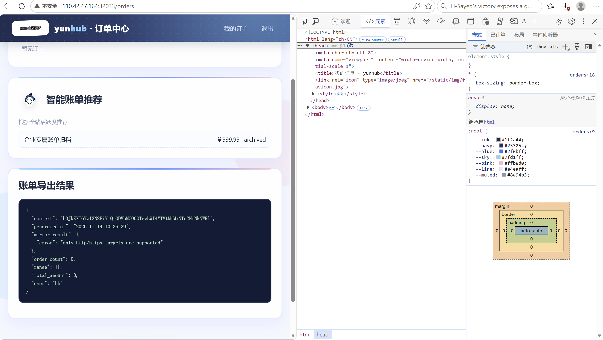
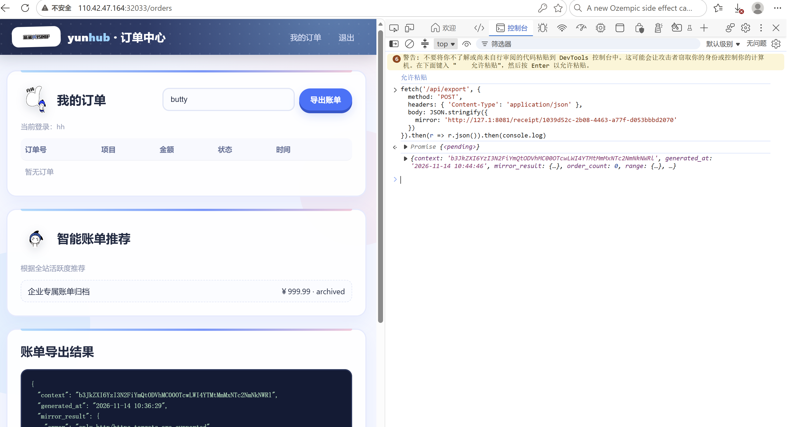

# ISCTF 2026 yunhub Writeup

> 记录一下第一次打 ISCTF 的 Web 题。这道题考的是 SSRF，这次是自己一点点试出来的，中间有些地方实在没思路，也问过 AI。踩过的坑都留在下面了。

## 目录

- [一、题目信息](#一题目信息)
- [二、注册账号和第一轮瞎试](#二注册账号和第一轮瞎试)
- [三、从导出接口找到订单号](#三从导出接口找到订单号)
- [四、发现 mirror 参数](#四发现-mirror-参数)
- [五、绕过滤器](#五绕过滤器)
- [六、扫内网端口](#六扫内网端口)
- [七、拿到 flag](#七拿到-flag)
- [八、注意事项](#八注意事项)
- [九、相关知识点](#九相关知识点)
- [十、总结](#十总结)

## 一、题目信息

- 题目名：yunhub
- 类型：Web
- 地址：`http://110.42.47.164:32033/`
- 提示：系统内有三个历史账号 yunbai、butty、alalei
- 考点：SSRF、越权

打开是一个蓝白色的账单管理平台，能注册登录、看订单、导出账单，右上角还有一个“云端同步地址”的输入框。题目说“平台贴心地准备了一个安全检查接口”，我一开始没找到这个接口在哪，后来才发现应该就是导出时对 `mirror` 的检查。

## 二、注册账号和第一轮瞎试

### 做题步骤

- **第一步** 注册账号，用户名填 `hh`，密码随便设了个 `123456`
- **第二步** 登录进去，按 `F12` 打开开发者工具，在 Network 里把页面加载的请求都看一遍
- **第三步** 发现 `/orders` 页面会调用 `/api/recommend` 和 `/api/export` 两个接口

一开始我的注意力全在那三个历史账号上，第一反应就是爆破密码。试了 `123456`、`password`、`admin`，还有跟用户名一样的密码，全部提示“用户名或密码错误”。

然后我又怀疑是 SQL 注入，在登录框里填 `yunbai' or 1=1 --`，返回还是同一句话，也没有数据库报错。这里我卡了快一个小时，一直在登录框上折腾。

### 注意

1. 题目给历史账号，不一定是要你爆破，也可能是在暗示“系统里有别人的数据”。我一开始就想错了方向。
2. 登录框没有报错，说明大概率是参数化查询，早点换方向比较好。

## 三、从导出接口找到订单号

### 做题步骤

- **第一步** 在订单页点一次“导出账单”，看 `/api/export` 返回了什么
- **第二步** 发现返回里有一个 `context` 字段，是一串 base64
- **第三步** 把它解开，得到 `order:c277abbd-85a0-4970-b8a3-2c15766cd5de`
- **第四步** 把后面的 UUID 拼到 `/api/order/` 后面访问，发现真的能打开订单详情

`/api/export` 的返回大概是这样：

```json
{
  "context": "b3JkZXI6YzI3N2FiYmQtODVhMC00OTcwLWI4YTMtMmMxNTc2NmNkNWRl",
  "generated_at": "2026-11-14 10:36:29",
  "order_count": 0,
  "range": {},
  "total_amount": 0,
  "user": "hh"
}
```

`context` 解出来是 `order:` 加上订单号，前面这个前缀其实就是在告诉你这是一条订单。

访问 `/api/order/c277abbd-85a0-4970-b8a3-2c15766cd5de`，返回：

```json
{
  "order_id": "c277abbd-85a0-4970-b8a3-2c15766cd5de",
  "title": "企业专属账单归档",
  "status": "archived",
  "amount": 999.99,
  "created_at": "2026-01-10 10:35:00",
  "remark": "*** 该内容需在渲染服务中查看 ***",
  "receipt_ref": "http://127.0.0.1:8081/receipt/1039d52c-2b08-4463-a77f-d053bbbd2070"
}
```

这里有两个很明显的地方：

1. `remark` 被替换成了星号，还写着“需在渲染服务中查看”，基本等于明示；
2. `receipt_ref` 是一个 `127.0.0.1:8081` 的地址。

`127.0.0.1` 是本机地址。我在自己电脑的浏览器里打开它，打开的其实是我自己电脑的 8081 端口，不是服务器的。所以必须让服务器自己去访问这个地址，这里就是 SSRF 的入口。

### 注意

- 这个订单不是我自己下的，但换个账号登录照样能看，说明订单详情接口没判断订单归属，这里是越权。
- `receipt_ref` 这种内部地址不应该直接返回给前端，等于把内网地图给出来了。

## 四、发现 mirror 参数

### 做题步骤

- **第一步** 回到 `/orders`，在“云端同步地址”里随便填一个网址
- **第二步** 点导出，看到返回里多了一个 `mirror_result` 字段
- **第三步** 填 `http://127.0.0.1:9/x`，返回 `target address is not allowed`

这说明两件事：服务器真的去请求了我填的地址，而且它有一张黑名单，`127.0.0.1` 被拦了。

用户能填网址、服务器还会去访问，这就是典型的 SSRF。接下来的问题就是怎么绕过这个黑名单。

## 五、绕过滤器

### 做题步骤

- **第一步** 先试了 `http://localhost/x`、`http://0.0.0.0/x`、`http://[::1]/x`，全部是 `target address is not allowed`
- **第二步** 换成 `http://127.1/x`，返回变成 `Connection refused`
- **第三步** 又试了 `http://2130706433/x` 和 `http://0x7f000001/x`，也是 `Connection refused`
- **第四步** 试 `file:///etc/passwd` 和 `gopher://...`，返回 `only http/https targets are supported`

`Connection refused` 的意思是过滤器已经过了，只是那个端口没有服务在跑。所以 `127.1`、整数写法、十六进制写法都是能绕过去的。

我理解的是，过滤器只检查字符串里有没有 `127.0.0.1` 这几个字，但真正去联网的程序认识 `127.1` 这种简写，会把它解析成同一个地址。两边理解不一样，就有空子钻。

IP 还能写成整数和十六进制，这个是我卡住的时候问 AI 才知道的，之前完全没往这个方向想。

试 `file://` 的时候报错很直白，说明只允许 http 和 https，这条路走不通：



### 注意

1. 黑名单只看字面，不看真正解析出来的 IP，这是绕过的关键。
2. IP 除了点分十进制，还有短写、整数、十六进制这些写法，平时可以记一下。

## 六、扫内网端口

### 做题步骤

- **第一步** 用 `127.1` 一个一个试常见端口，看返回是拒绝还是正常
- **第二步** 试到 `8080`，返回的是 yunhub 的登录页，说明是主站自己
- **第三步** 试到 `8081`，返回 `{"service":"yunhub-renderer","status":"ok"}`

8081 上跑的是一个叫 `yunhub-renderer` 的渲染服务，和订单里那个 `receipt_ref` 正好对上。

### 注意

- 扫端口的时候不要只看“有没有返回”，`Connection refused` 和 404 的意义是不一样的，前者是端口没开，后者是服务在但路径不对。

## 七、拿到 flag

### 做题步骤

- **第一步** 把 `receipt_ref` 整个填进 `mirror`，只需要把 `127.0.0.1` 换成 `127.1`
- **第二步** 在返回的 `mirror_result.body` 里找 `remark`

我是在浏览器控制台里发的请求：

```js
fetch('/api/export', {
  method: 'POST',
  headers: { 'Content-Type': 'application/json' },
  body: JSON.stringify({
    mirror: 'http://127.1:8081/receipt/1039d52c-2b08-4463-a77f-d053bbbd2070'
  })
}).then(r => r.json()).then(console.log)
```

返回的 body 是渲染服务吐回来的内容，`remark` 这一栏终于是明文了：

```json
{
  "amount": 999.99,
  "order_id": "c277abbd-85a0-4970-b8a3-2c15766cd5de",
  "remark": "ISCTF{900bf06188abb8caae94ade90c7a566d}",
  "status": "archived",
  "title": "企业专属账单归档"
}
```



所以最终的 flag 是：

```
ISCTF{900bf06188abb8caae94ade90c7a566d}
```

## 八、注意事项

1. Windows 的 PowerShell 里直接敲 `curl` 其实是 `Invoke-WebRequest` 的别名，参数完全不一样，要用 `curl.exe`。我一开始就被这个坑了，后来干脆都在浏览器控制台里发请求。
2. `127.0.0.1` 不能直接复制到浏览器打开，那是自己电脑的地址，得让服务器替你去访问。
3. 报错信息不要忽略。`target address is not allowed` 这句话直接告诉我哪条路被堵了，比瞎试有用得多。
4. 导出接口的报错把 `urllib` 的名字漏出来了，说明它没有处理异常，以后自己写代码也要注意别把这种信息返回给用户。
5. 提交之前再核对一遍 flag 格式，别复制漏了。
6. 问 AI 不丢人，但最好把它给的方法自己再复现一遍，知道为什么能行，不然换个题还是不会。

## 九、相关知识点

1. **SSRF**：服务端请求伪造。简单说就是服务器提供了“帮你访问网址”的功能，但没有限制访问范围，于是可以用它去访问内网。这题里就是 `mirror` 参数。
2. **黑名单绕过**：过滤规则和实际解析不是同一套逻辑。过滤器看到的是字符串，真正联网的程序会先把域名或 IP 解析成地址，两边对不上就能绕。
3. **IP 的几种写法**：`127.0.0.1` 可以写成 `127.1`、`2130706433`、`0x7f000001`，指向的是同一个地址。
4. **越权**：登录了不代表能看别人的数据。这题的订单详情接口只判断有没有登录，没判断订单是不是你的。
5. **端口探测**：内网里不知道有什么服务时，可以一个端口一个端口试，用返回的差异判断服务是否存在。

## 十、总结

完整流程其实不复杂：

注册登录 → 导出接口的 `context` 解出订单号 → 订单详情拿到 `receipt_ref` → `mirror` 填 `127.1:8081` 的地址 → 在渲染服务的返回里读 flag。

但这道题我做了挺久，大部分时间都花在错误的方向上。一开始以为要爆破密码，后来又以为登录框有 SQL 注入，真正有用的线索其实是导出接口返回的那串 base64 和订单里的 `receipt_ref`。

最大的收获是第一次自己把一个 SSRF 从发现到绕过完整走了一遍，也知道了报错信息有多重要。以前做靶场都是照着 writeup 点，这次至少是自己试出来的（虽然也卡了很久）。

后面如果再遇到“用户能填网址”的功能，我应该会先想到 SSRF，而不是先去猜密码了。
