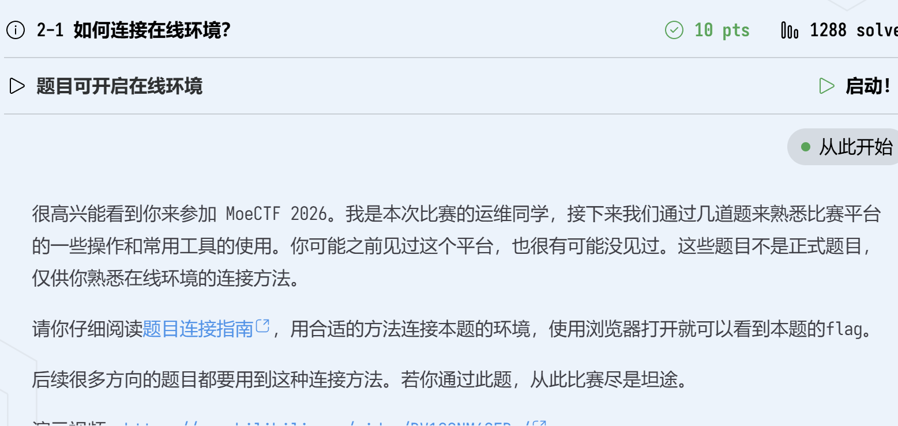
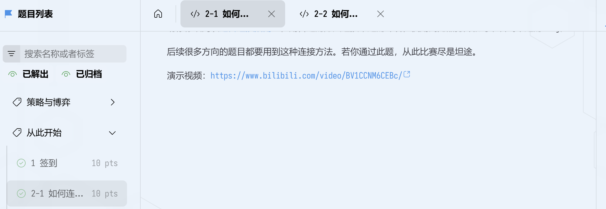
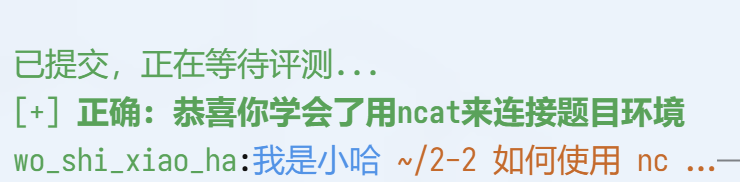
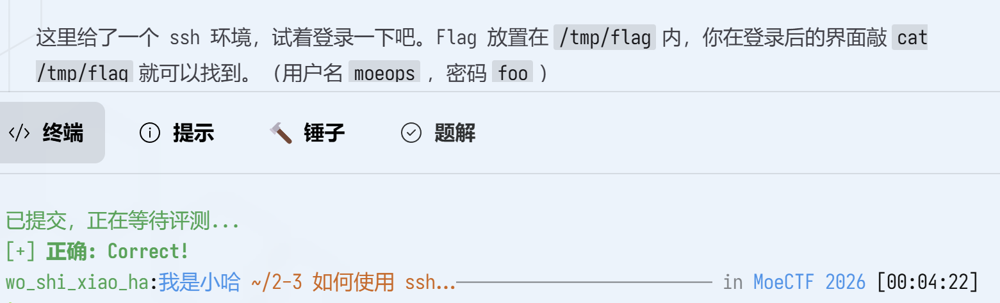
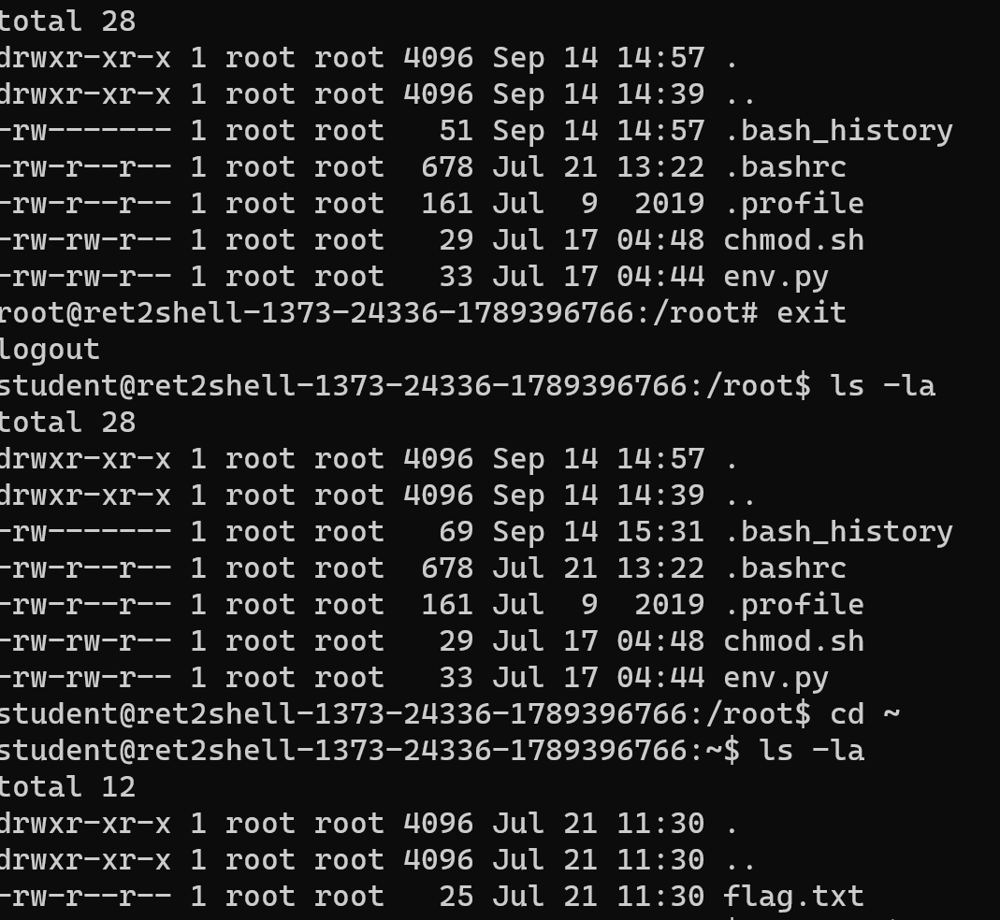
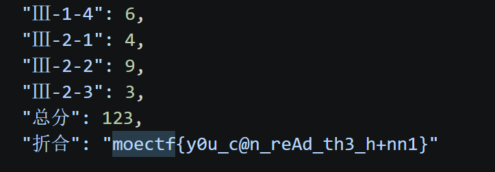
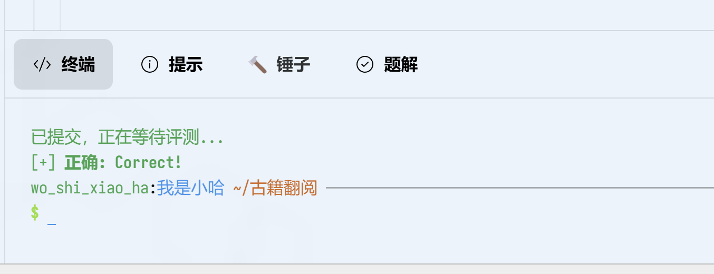

# MoeCTF 2026 Writeups

> 记录第一次打 MoeCTF 的全过程：从连不上环境，到拿到第一个 flag。
> 所有题目按顺序整理在这一篇里，踩过的坑都留着。

## 目录

- [一、如何连接在线环境](#一如何连接在线环境)
- [二、如何使用 nc 连接环境](#二如何使用-nc-连接环境)
- [三、如何使用 ssh 连接环境](#三如何使用-ssh-连接环境)
- [四、Linux 虚拟环境安装和基础命令](#四linux-虚拟环境安装和基础命令)
- [五、命令提示符](#五命令提示符)
- [六、查小 M 的成绩（Web）](#六查小-m-的成绩web)
- [七、古籍翻阅（Web · 爆破与路径穿越）](#七古籍翻阅web--爆破与路径穿越)
- [八、关于 C 语言和 Python 的初尝试](#八关于-c-语言和-python-的初尝试)

## 一、如何连接在线环境

### 步骤

- **第一步** 点击官方的**题目连接指南**
- **第二步** 找到下方的**国内镜像**
- **第三步** 根据电脑本身的型号选择对应的下载链接，注意版本的选择
- **第四步** 解压文件
- **第五步** 打开并允许西电域名
- **第六步** 返回题目开启**在线环境**
- **第七步** 将对应的号码复制到浏览器，获得对应的 flag





## 二、如何使用 nc 连接环境

### 解题步骤

- **第一步** 阅读 **如何使用 netcat** 维基
- **第二步** 点击 **nmap 下载链接** 根据具体情况选择（我选择了 Windows 系统的 nmap，但是我的 Linux WSL 链接一直打不开）
- **第三步**（个人认为这是难点，需要注意路径问题）在**此电脑**中找到 nmap 的文件夹，寻找 nc 文件（因为我最开始把 nmap 不小心下在了 D 盘里）
- **第四步** 同时按 **R 键** 和 **Windows 键** 激活 CMD
- **第五步** 返回题目点击**启动**，获得 WSRX 的相关数据
- **第六步** 将所复制的链接输入 WSRX（Ctrl+V）后点击箭头启动，获得**真正的端口号**
- **第七步** 在 CMD 中输入 `ncat localhost <端口号>`，然后回车
- **第八步** 完成机器人验证，获得 flag
- **第九步** 输入题目终端验证



### 注意事项

- 第一，下载 nmap 时最好下载在 C 盘
- 第二，不要把 WSRX 右下角的数字默认为需要的端口号，必须去**启动**
- 第三，注意时效性，否则得到的端口号无效

## 三、如何使用 ssh 连接环境

**用到的平台：CMD、WSRX**

### 解题步骤

- **第一步** **启动**并打开 CMD
- **第二步** 根据提示输入至 WSRX 获得**端口号**
- **第三步** 在 CMD 中输入 `ssh moepos@127.0.0.1 -p<端口号>`
- **第四步** 在密码提示后输入密码 `foo` 并回车，登入 ssh
- **第五步** 在 `$` 后面输入 `cat /tmp/flag` 获得 flag



### 注意

输入密码时密码是**“隐形的”**，需要盲打，不要以为是卡住了。

## 四、Linux 虚拟环境安装和基础命令

> 难度：难。一直在踩坑。

### 解题步骤

- **第一步** 阅读下方有关的基础命令，点击启动，复制到 WSRX 中得到端口号
- **第二步** 打开 CMD，使用 ssh 连接环境：`ssh 用户名@IP -p 端口号`
- **第三步** 输入密码（注意仍然是“隐形的”），进入 Linux 的虚拟环境
- **第四步** 尝试题目中的各种命令（我觉得非常难，刚开始没有任何效果，一直在碰壁。我尝试用 `ls -la`、`cat` 等查看文件，没有发现任何与 flag 有关的东西）
- **第五步** 尝试用 `su -` 转换视角至 root 用户查看文件，发现没有 flag（我重新阅读了题目，发现题目中给了超级管理员的密码，再结合下面命令中给到的 su 用法，于是我尝试了切换身份；重新读取文件发现依然没有发现 flag。后面我重新退回 student 用户身份，再次使用 `ls -la` 读取，发现了 flag 文件）
- **第六步** 输入 `exit` 退回至 student 用户，用 `cd ~` 回到家目录，再次使用 `ls -la` 读取文件，在其中发现了 flag 文件



### 注意与提醒

1. 第一次用 `ls -la` 查看文件只发现了 `chmod.sh` 和 `env.py`，误以为 flag 在里面，尝试了多次环境变量测试 —— **不要被诱饵文件带偏**
2. 应该仔细阅读题目中的有效信息，但要注意辨别。比如发现题目给了超级管理员的密码时，在 root 身份下再次查看文件依然不在 —— **不要迷信 root 权限**
3. 以后可以先尝试 `cd ~` 查看家目录，这样可以更快速地获取信息 —— **不要一直卡在某个思维定局里**

### 总结

虽然花费了将近一个小时绕弯子，不过让我真正地了解了 Linux 的目录，还是很值的。

## 五、命令提示符

### 解题步骤

- **第一步** 下载相关文件（题目中提到会出现闪退，可以思考一下是不是应该换一个不会关掉的终端。我注意到文件名字中的 cmd，认为这是一个提示，意味着我们可能需要使用 cmd；DeepSeek 也提到可以给它一个保持窗口的命令）
- **第二步** 在 CMD 中进入所需的文件夹，输入 `cd <文件夹的名字>`
- **第三步** 在文件夹中输入文件名称 `signin-cmd.exe` 再点回车，得到 flag

### 注意

1. 下载文件时最好下载在 C 盘中（我第一次就是下载在 D 盘中，结果导致 CMD 无法“进入”）
2. 在 CMD 中可以使用 `dir` 查看所需的文件是否存在
3. 文件名一定要打双引号！

### 小妙招

在输入文件名时可以先输入前面再按 Tab 键自动补全，比如输入 `signin` 再按 Tab。

（由于格式问题，暂不展示截图）

### 一点点说明

开始的时候没有思路，所以点开了提示，得到了以下内容：

```
wget      下载指定的文件。
whoami    显示与当前的有效用户 ID 相关联的用户名。
```

完成后我询问了相关资料，得知 `wget` 和 `whoami` 是 Linux 的解法，但我是通过 Windows 中的浏览器和 CMD 完成的。

## 六、查小 M 的成绩（Web）

### 解题步骤

- **第一步** 下载对应文件至电脑中
- **第二步** 打开文件，发现自己没有学号等有用的线索，尝试输入了 WSRX 的端口号，发现没有效果
- **第三步** 发现题目中提到“查分系统是一个静态网页”，且附件是一个纯文本系统，尝试打开文件本身
- **第四步** 用 VS Code 打开文件，得到源代码
- **第五步** 发现里面有一堆的学号，点击 `Ctrl+F` 进行查找，输入 `moectf`，得到真正的学号以及 flag



### 一点点小经验

1. 以后遇到文件、没思路的时候可以先查看源代码，然后再进行搜索
2. 静态文件不走网络请求，暗示了逻辑在前端，可以直接找源代码

## 七、古籍翻阅（Web · 爆破与路径穿越）

### 做题步骤

- **第一步** 打开在线环境，复制 WSRX 获得端口号，在浏览器输入 `http://127.0.0.1:端口号` 打开对应页面
- **第二步** 按 `Fn + F12` 打开开发者工具，用 `Ctrl+F` 在 Elements 中尝试寻找 flag，得到 **/read?book=jing/liji/flag**（由此猜测 **/read?book=** 是不是有可能为一个接口链接）
- **第三步（踩坑与碰壁）** 直接在浏览器访问 **/read?book=jing/liji/flag**，通过题目所给的文件.txt 手动连接各种路径（全部得到 404，思路中断）
- **第四步（各种试错、询问 AI）**
  1. 尝试读取目录文件本身 **http://127.0.0.1:端口号/read?book=guji_catalog.txt**，没有用处
  2. 尝试最经典的**目录穿越**（仍然踩坑，尝试了 **http://127.0.0.1:端口号/read?book=../../../../etc/passwd**，无法读取系统文件）
  3. 尝试直接去根目录拿 flag（最最最可惜的一个方法，因为尝试的层数不够，只尝试了 4 个，但正确答案是 6 个）。在浏览器输入 **http://127.0.0.1:端口号/read?book=../../../../flag**，因为层数不够，退回

### 查看题解后（官方 writeup）

1. 需要对**古籍目录**进行爆破，发现仅有一个目录是 200（成功），访问后可以得到 hint（提示）
2. 可以发现 flag 藏在根目录下
3. 重新改变 GET 提交的值为 `../../../../../../flag`



### 相关知识点

1. 在 **/read?book=jing/liji** 中，`book` 是参数名，`jing/liji` 是参数值（突破口）
2. 需要学会用工具或脚本进行爆破（我还不会的地方），以得到关键线索
3. `.` 代表**当前目录**，`..` 代表**上一级目录**
4. 以后可以多敲几个 `../` 用来退到根目录

## 八、关于 C 语言和 Python 的初尝试

（这部分还在整理中，后续补充。）
